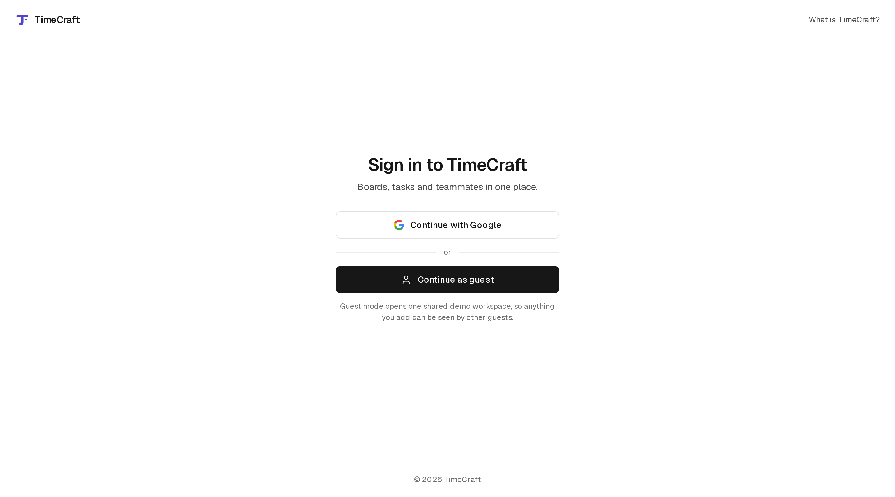
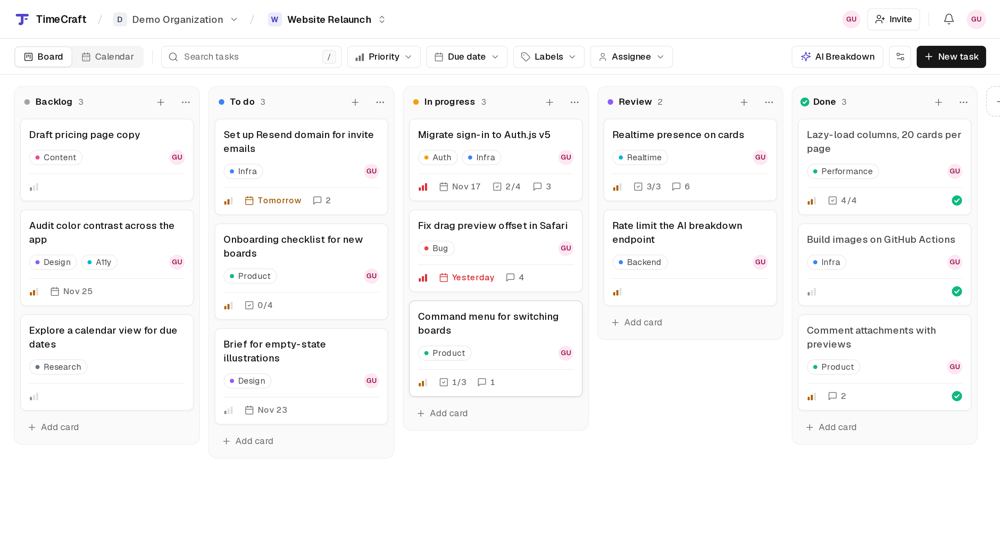
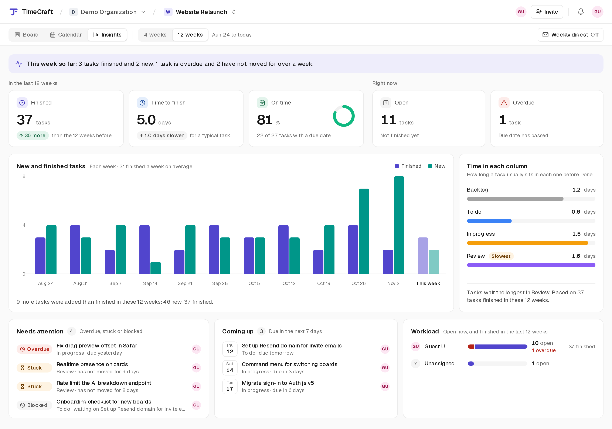
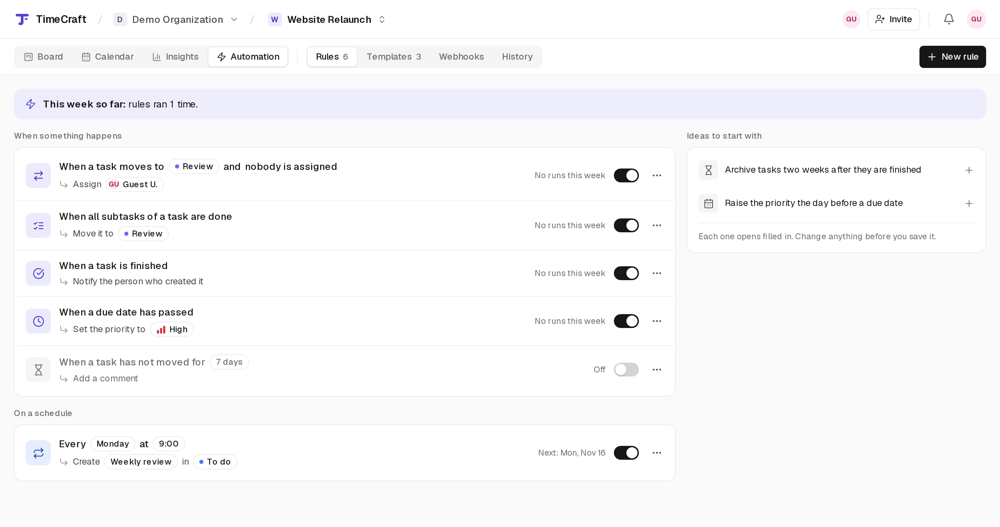

# TimeCraft

A real-time Kanban project management SaaS built with Next.js 16, React 19, and TypeScript.

### 🌐 Live demo: **[noravut.dev](https://noravut.dev)** — click **Continue as guest**, no sign-up, 10 seconds
Self-hosted on AWS EC2 (Docker + Caddy HTTPS) — see [Deployment](#deployment).

[](https://github.com/noravutC/next-timecraft/actions/workflows/ci.yml)


## Features

- **AI Task Breakdown**: type a goal and Claude or Gemini streams it into actionable cards on the board
- **Kanban Board**: drag-and-drop columns and cards with fractional ordering, WIP limits, filters and a calendar view
- **Insights**: a board's numbers over 4 or 12 weeks (tasks finished and added per week, time to finish, how many met their due date, time in each column) beside how it stands now (what is overdue, stuck or blocked, what is due next, who holds what), and an optional weekly digest email
- **Automation**: rules that act on a board for you (when a task moves, is finished or is assigned, when a due date comes up or passes, when a task sits still, or at a set time), task templates and repeating tasks, signed webhooks to other apps with retries, and a history of everything that ran
- **Task detail**: subtasks, assignees, tags, due dates and reminders, dependencies (blocked tasks), estimates and logged time, an activity trail
- **Comments**: mentions, reactions and image/video attachments
- **My tasks, search and notifications**: everything assigned to you across boards, ⌘K search over tasks and boards, in-app and email notifications
- **Real-time Collaboration**: changes sync instantly across all project members over private channels
- **Optimistic UI**: every action applies at once, rolls back on failure and offers Undo
- **Multi-tenant**: organizations with boards and members, role-based access control, email invitations
- **Sign-in**: Google OAuth, or Continue as guest on a shared demo workspace that is rebuilt nightly
- **Export and calendar feed**: a board as CSV, due dates as an iCal subscription
- **Soft Delete**: safe column deletion with scheduled purge

## Screenshots

**Login Page**


**Kanban Board**


**Insights**


**Automation**



## Tech Stack

| Layer | Technology |
|---|---|
| Framework | Next.js 16 (App Router), React 19 |
| Language | TypeScript 5 |
| Styling | Tailwind CSS v4, shadcn/ui, Framer Motion |
| State | Zustand 5 |
| Database | PostgreSQL (Supabase) via Drizzle ORM |
| Auth | Auth.js v5 (`next-auth` beta): Google OAuth and guest sign-in, JWT |
| Real-time | Pusher WebSocket |
| Drag & Drop | Atlaskit pragmatic-drag-and-drop |
| AI | Anthropic and Google Gen AI SDKs, bring your own key |
| Observability | pino, Sentry, OpenTelemetry |
| Tests | Vitest, React Testing Library, Playwright, axe |
| Package Manager | pnpm |

## Architecture

```
src/
├── app/
│   ├── (main)/        # Authenticated route group
│   │   ├── project/   # Kanban board and calendar
│   │   ├── my-tasks/  # Tasks assigned to you, across boards
│   │   ├── notifications/
│   │   └── settings/  # Profile, workspace, members, usage
│   ├── (marketing)/   # Landing page, case study, privacy, terms
│   ├── api/           # REST API routes (shared handler wrapper)
│   └── login/         # Google OAuth and guest sign-in
├── store/             # Zustand global state
├── services/          # API service layer
├── db/                # Drizzle ORM schema & queries
├── lib/               # RBAC, API wrappers, AI, telemetry, security
├── components/        # UI components (shadcn/ui)
└── types/             # TypeScript type definitions
drizzle/               # SQL migrations
e2e/                   # Playwright tests
```

## AI Task Breakdown — design notes

The board has an **AI breakdown** button: describe a goal, pick a column, and an LLM
turns it into cards that appear one by one as they are generated.

**Bring your own key, two providers.** Each user picks a provider — **Claude**
(`claude-opus-4-8`, official `@anthropic-ai/sdk`) or **Gemini** (`gemini-2.5-flash`,
official `@google/genai`) — and stores their own API key from the AI settings panel.
Keys are encrypted at rest (AES-256-GCM, `src/lib/ai/crypto.ts`) in the `ai_settings`
table and are never returned to the client — the API only reports whether a key is
set. A server-side `ANTHROPIC_API_KEY` acts as an optional shared fallback. Every
request writes a row to `ai_usage_logs` with the provider, model, input/output token
counts, task count, and outcome (`success` / `error` / `refusal`) — the raw material
for per-user usage dashboards and cost attribution.

**How it streams.** `POST /api/ai/task-breakdown` (session + RBAC-checked like every
other route) opens a streaming request to Claude and forwards results to the browser
as Server-Sent Events. The client inserts each subtask through the existing task
store, so AI-created cards get the same optimistic updates and Pusher broadcast as
manually created ones.

**Prompt design.** The system prompt instructs Claude to answer in **NDJSON** — one
`{"title", "description", "priority"}` object per line, ordered by execution order,
in the user's language. Each completed line is validated with Zod on the server;
lines that fail validation are silently dropped, so the client can never receive a
malformed task.

**Trade-offs considered.**
- *NDJSON vs. structured outputs (`output_config.format`)*: structured outputs give a
  schema-guaranteed document, but the guarantee applies to the whole response — you
  can't validate-and-forward items while the stream is still running without a
  partial-JSON parser. NDJSON keeps streaming trivial (split on newline) and moves the
  schema guarantee into per-line Zod validation instead.
- *Server-side vs. client-side task creation*: the server only proxies the AI; the
  client creates tasks through the normal `POST /api/task` path. This reuses the
  existing permission checks, optimistic store logic, and realtime broadcast instead
  of duplicating them inside the AI route.
- *Error handling*: rate limits / auth / network failures from the Anthropic SDK are
  mapped to human-readable SSE `error` events (the SDK already retries transient
  429/5xx twice with backoff). If the stream dies mid-way, the user keeps the cards
  that were already created — nothing is rolled back.

## Done column: design notes

One column per board is the **Done column** (a check mark in its header;
new boards get it on the last column of the template). A task is finished
when it sits in that column: Done is a place, not a second flag that can
disagree with where the card is. Tick a card, use its menu or the button in
the task sheet and it moves there; untick it and it returns to the column it
came from, with Undo either way.

`tasks.completed_at` and the column a task was completed from are kept by
Postgres triggers (migration `0023`), not by application code, because six
different code paths can move a task. Blocked badges, My tasks and the
calendar all read the same definition.

## Insights: design notes

The Insights view is the third way to look at a board, beside the columns
and the calendar. Everything in it is counted in SQL from what the board
already records, so there is no reporting table to keep in step:

- The numbers come in two groups, "In the last 12 weeks" and "Right now",
  so it is clear which ones the period switch changes. One sentence above
  them sums up the week so far.
- **Finished** means `completed_at` in the Done column, archived or not:
  archiving finished work does not undo it. **New** counts every task added
  in a week, whatever became of it since. Weeks run Monday to Sunday in the
  viewer's time zone.
- **Time to finish** is the median from created to Done, not the mean, so
  one task that sat for months does not move it.
- **On time** is the share of finished tasks with a due date that were
  finished on the due day or before it.
- **Time in each column** replays each finished task's moves from its
  activity history and averages the time spent in each column.
- **Stuck** is an open task outside the first column that has not changed
  column for 7 days. The first column is left out: a backlog is where tasks
  are meant to wait.
- **Coming up** lists open tasks due today or in the six days after.

The weekly digest is opt-in per person per board (`digest_subscriptions`).
The scheduled job sends it on Monday from 9:00 in the workspace's time zone
and claims each week before sending, so two runs at once send it once. A
week with nothing to report is not sent.

## Automation: design notes

Automation is the fourth view of a board. It holds four things: rules,
task templates, webhooks, and the history of what ran.

**Rules.** A rule reads "When this happens, only if that holds, then do
these things". There are ten triggers and ten actions, and the page shows
every rule as that sentence.

- Every change to a task already passes through one function, the one that
  writes its history (`recordTaskActivities`). That is the single place
  rules and webhooks listen, so no route has to remember to tell them.
- A rule that waits for a change runs in the request that made the change.
  The response and the realtime events already carry what the rule did, so
  the card never shows a state the rule is about to change.
- What a rule does is a change like any other, so it can start other
  rules. A chain stops after three rules, and a rule never runs twice for
  the same task in one chain. The stop is written to History.
- A step that would leave the task as it already is, is skipped. Running a
  rule twice changes nothing the second time.
- A rule that points at a column, label, person or template that is gone
  is paused with the reason ("Needs a fix") until it is saved again.
- Rules that wait for a date or a time run from the scheduled job, every
  five minutes. A schedule is claimed by moving its next time forward in
  one statement, so two job runs never both take the same occurrence, and
  a schedule missed while the job was down runs once, not once per miss.
  Date rules claim a row per rule, task and date, so each fires once.
- A repeating task is a rule "at a set time" that creates a task from a
  template. Times are in the workspace's zone.

**Webhooks.** A webhook tells another app what happens on a board.

- The message is written to `webhook_deliveries` when the event happens
  (the outbox), and sent after the response has gone out. If the receiver
  does not answer with a 2xx it is tried again: five tries in all, about
  half a day apart at the longest. Every try is in History, and one that
  failed can be sent again by hand.
- Each request is signed (`X-TimeCraft-Signature`, the HMAC-SHA256 of the
  body with the webhook's secret) and carries an id
  (`X-TimeCraft-Delivery`) the receiver can use to drop a repeat.
- The secret is shown once and stored encrypted. Only owners and admins of
  a board see its webhooks: an address can carry a token.
- A webhook can only reach the public internet. The address must be
  https, private and link-local ranges are refused when the connection is
  made (so a name cannot resolve to something safe for a check and
  something else for the request), redirects are not followed, and the
  receiver has ten seconds to answer.
- The shared guest workspace has no webhooks: nothing leaves the server on
  the say of an account anyone can use.

## Testing

- **Unit and component tests** (Vitest): pure logic runs in node; components
  render in jsdom with React Testing Library and are queried the way a
  screen reader sees them (role and accessible name).
- **Coverage gate**: CI fails if coverage drops under the thresholds in
  `vitest.config.mts`, a ratchet that only moves up (pure utilities are held
  to 80% lines).
- **End to end** (Playwright): the real app on a throwaway Postgres in CI:
  sign-in, drag and drop, the task sheet, filters.
- **Accessibility**: `e2e/a11y.spec.ts` runs axe against the landing page,
  login, the board, Insights, Automation and the rule editor, and fails on
  any serious or critical WCAG 2.1 A/AA violation.

## Deployment

Two supported paths:

| Path | What it is | Guide |
|---|---|---|
| **Vercel** | Zero-config: connect the repo, set env vars, deploy | — |
| **Docker on AWS EC2** | Multi-stage image (`Dockerfile`, Next.js standalone output ≈ small runtime, non-root user, built-in `HEALTHCHECK` hitting `/api/health`) behind a Caddy HTTPS proxy — **this is what serves [noravut.dev](https://noravut.dev)** | [docs/deploy-aws.md](docs/deploy-aws.md) |

For local container work there's a `docker-compose.yml` (app + Postgres 16):

```bash
cp .env.docker.example .env.docker   # fill in values
docker compose up --build
```

`GET /api/health` reports app + database status (`200 ok` / `503 degraded`) for
load balancers and uptime monitors. CI builds the production image on every PR.

**Delivery.** Every push to `main` builds the image and pushes it to GHCR,
one run at a time so `latest` always is the newest commit. `scripts/deploy.sh`
starts it, waits for `/api/health`, and rolls back to the previous image by
itself if the new one never becomes healthy. The Deploy workflow runs
migrations and that script on the server through AWS Systems Manager with
short-lived OIDC credentials: no SSH port, no stored keys. Dependabot keeps
dependencies, actions and the base image current, and CodeQL scans every PR.

## Performance & hardening

- **Core Web Vitals** (Lighthouse against the live AWS deployment, `/login`):
  **100 desktop / 98 mobile** — LCP 0.5s/2.3s, TBT 0ms/100ms, **CLS 0** on both.
- **Rate limiting** — every authenticated API request passes a per-user,
  per-path sliding-window limiter in the shared handler wrapper (default
  120 req/min; the AI route is capped at 10 req/min since LLM calls are the
  most expensive thing the app does). Exceeding it returns
  `429 Too many requests — retry in Ns`. Implemented in-memory
  (`src/lib/api/rate-limit.ts`) because the app runs as a single container —
  the module is a drop-in swap point for Upstash Redis if it ever scales
  horizontally.

- **Indexes sized by a load test**: `scripts/perf/` seeds 98,000 tasks into
  a scratch database and runs a k6 scenario of 50 concurrent users. Adding
  the indexes in migration `0022` (board order, foreign keys, trigram
  indexes for search) took p95 from 733 ms to 98 ms and throughput from 70
  to 112 req/s. Search keeps `ILIKE '%words%'` on `pg_trgm` GIN indexes
  rather than `tsvector`: it matches inside words and works for Thai, which
  has no spaces for a text-search parser to split on.

## Observability

- **Structured logging** — every API request goes through the shared handler
  wrapper (`src/lib/api/handle.ts`) which emits one JSON log line via **pino**:
  method, path, status, duration, userId. Unhandled errors log with full stack.
  `docker logs timecraft` therefore yields grep-able JSON, ready for CloudWatch.
- **Error tracking (Sentry)**: DSN-gated. Set `SENTRY_DSN` (server) and
  `NEXT_PUBLIC_SENTRY_DSN` (client, a Docker build arg) and both runtimes
  report unhandled errors, API 500s and React render crashes
  (`global-error.tsx`). With no DSN the integration is a no-op. The Docker
  build on `main` uploads source maps when the repo has a `SENTRY_AUTH_TOKEN`
  secret plus `SENTRY_ORG` / `SENTRY_PROJECT` variables, so production stack
  traces point at the original TypeScript.
- **Tracing and metrics (OpenTelemetry)**: set `OTEL_EXPORTER_OTLP_ENDPOINT`
  (and `OTEL_EXPORTER_OTLP_HEADERS` for auth) and the server exports to any
  OTLP backend: Grafana Cloud, Honeycomb, a local collector. Traces are the
  spans Next.js emits per request (route handler, render, proxy), tagged with
  the user id. Metrics are `http.server.request.duration` per route, method
  and status, and one histogram per Core Web Vital. Without the endpoint
  nothing is set up. With Sentry on as well, Sentry owns the tracer and the
  spans it samples go to both (`src/lib/telemetry/otel.ts`).
- **Log correlation**: inside a traced request every log line carries
  `traceId` and `spanId`, so a slow trace leads straight to its logs.
- **Real-user Web Vitals**: every page reports LCP, INP, CLS, FCP and TTFB
  from the visitor's browser to `POST /api/vitals` (rate limited per IP,
  nothing stored), which logs them and records the histograms above.
- **Service levels** (targets, measured from the metrics above):
  99.5% of API requests answer without a 5xx; p95 API latency under 500 ms;
  75% of page loads with LCP under 2.5 s and INP under 200 ms. Uptime:
  `GET /api/health` checks the database, and the 5-minute jobs workflow
  fails (GitHub emails the owner) whenever the app is unreachable.

## Getting Started

### Prerequisites

- Node.js 20+
- pnpm
- A PostgreSQL database (Supabase in production)
- Pusher account
- Google OAuth credentials (optional: guest sign-in works without them)

### Setup

```bash
pnpm install
pnpm db:migrate   # applies drizzle/*.sql to DATABASE_URL
pnpm dev
```

### Environment Variables

```env
DATABASE_URL=
GOOGLE_CLIENT_ID=
GOOGLE_CLIENT_SECRET=
NEXTAUTH_SECRET=
PUSHER_APP_ID=
PUSHER_KEY=
PUSHER_SECRET=
PUSHER_CLUSTER=
NEXT_PUBLIC_PUSHER_KEY=
NEXT_PUBLIC_PUSHER_CLUSTER=
ANTHROPIC_API_KEY=   # optional — shared Claude fallback for AI Task Breakdown (users can bring their own key)
AI_ENCRYPTION_KEY=   # optional — dedicated secret for encrypting stored AI keys (falls back to NEXTAUTH_SECRET)
SENTRY_DSN=              # optional — server-side error tracking (off when empty)
NEXT_PUBLIC_SENTRY_DSN=  # optional — client-side error tracking (build-time on Docker)
LOG_LEVEL=               # optional — pino level, default "info"
```

The full list, including email (Resend), comment attachments (Supabase
storage), cron and OpenTelemetry, is in [CLAUDE.md](CLAUDE.md#required-environment-variables).

### Commands

```bash
pnpm dev            # Start dev server (Turbopack)
pnpm build          # Production build
pnpm lint           # ESLint
pnpm typecheck      # tsc --noEmit
pnpm test           # Vitest (logic and component tests)
pnpm test:coverage  # same, with the coverage gate CI uses
pnpm db:generate    # Generate a migration from the schema
pnpm db:migrate     # Apply migrations
pnpm demo:reset     # Rebuild the shared guest workspace
```
